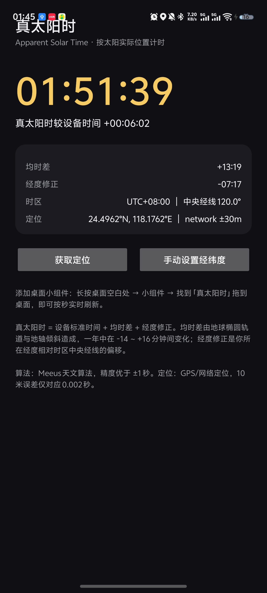

# 真太阳时 Apparent Solar Time

根据当前位置（GPS）计算**真太阳时**（视太阳时，Apparent Solar Time），主界面实时显示，桌面小组件**按秒刷新**。核心算法为纯 Kotlin 模块，设计上可直接复用于 iOS / macOS / Windows。

<p align="center">
  
  &nbsp;&nbsp;&nbsp;&nbsp;
  
</p>

## 真太阳时是什么

手表/手机显示的是「平太阳时」——假设太阳每天以相同速度绕天顶走一圈。但地球轨道是椭圆、地轴又是斜的，**真实太阳每天走得快慢不一**，日晷与钟表之差全年可在 -14 ~ +16 分钟之间摆动：

```
真太阳时 = 设备标准时间 + 均时差(EoT) + 经度修正
         = UTC + 经度 × 4分钟/度 + 均时差
```

- **均时差**：地球椭圆轨道 + 地轴倾斜造成，11 月初最大（+16.4 分），2 月中最小（-14.2 分）
- **经度修正**：所在经度相对时区中央经线（如东八区 120°E）的偏移，1° = 4 分钟
- **算法**：Meeus《Astronomical Algorithms》第 25/28 章（含章动、光行差），精度优于 ±1 秒；单元测试与 NOAA 太阳计算器参考值比对

## 功能

- 🛰️ GPS / 网络 / 融合定位自动获取经度（系统 API，无 Google Play 依赖），也可手动输入经纬度
- ⏱️ 主界面每 250ms 刷新：真太阳时 + 均时差 + 经度修正 + 时区信息
- 📱 桌面小组件按秒走字，支持调整大小
- 主界面和小组件显示当前真太阳时时辰（子时至亥时），每两个小时切换，子时从 23:00 开始。
- 🔋 无前台服务、无每秒后台轮询；整点短暂唤醒校准，系统定期更新作为兜底。
- 关于：点击主页底部「关于」，可分别复制作者 GitHub 地址和抖音号。

## 秒级刷新是怎么做到的

系统不允许（也不需要）每秒刷新小组件：

1. RemoteViews 里的 `Chronometer` 以「真太阳午夜」为锚点**自行按秒走字**；
2. 每个真太阳整点校准一次，同时更新时辰；计算下一整点时计入均时差变化，避免提前触发；
3. 使用允许空闲期间执行的唤醒闹钟，避免睡眠跨日后计时器继续累计到 24 小时以上；系统约每 30 分钟的组件更新提供独立恢复入口（实际时间可能受省电策略推迟）；
4. 开机 / 改时间 / 改时区 / 覆盖安装 / 授予精确闹钟权限后重建锚点；点击组件或调整组件大小也会立即校准。

小组件时钟统一补齐为 `HH:MM:SS`（例如 `00:50:21`、`01:00:00`），补零随系统计时器显示自动变化，不依赖精确闹钟权限或整点刷新。

Android 14+ 默认拒绝精确闹钟（`SCHEDULE_EXACT_ALARM`），应用内提供一键跳转授权。未授权时使用允许空闲期间执行的不精确闹钟，整点、午夜及换时辰可能延迟。权限在检查后被撤销时也会自动降级。系统强制停止应用或厂商极限省电仍可能阻止后台校准，此时可点击组件恢复。

## 项目结构

```
core-solar/            ★ 核心算法（纯 Kotlin，零平台依赖，可跨平台复用）
  src/main/kotlin/.../SolarTime.kt      均时差 + 真太阳时快照
  src/test/kotlin/...                   均时差参考值、时辰边界及跨午夜调度测试
app/                   Android 应用
  MainActivity.kt      主界面：实时时钟、定位、手动经纬度
  LocationEngine.kt    GPS/网络/融合定位
  LocationStore.kt     最后定位持久化（10 米误差仅对应 0.002 秒，无需频繁刷新）
  SolarWidget.kt       小组件刷新 + 整点锚点校准调度
  SolarWidgetProvider  AppWidgetProvider
  BootReceiver.kt      开机/时间变化/升级后重建锚点
```

## 构建

```bash
./gradlew :core-solar:test        # 核心算法测试
./gradlew :app:assembleDebug      # 调试 APK
./gradlew :app:assembleRelease    # 正式签名 APK（读取根目录 keystore.properties）
```

签名密钥 `keystore/solar-release.jks` 与 `keystore.properties` 随私有仓库保存，保证任何机器构建出的 APK 签名一致、可覆盖安装。**若将来开源，请先把它们移出仓库并更换签名。**

## 安装

从 [Releases](../../releases) 下载 APK 安装；或 `adb install -r app/build/outputs/apk/release/app-release.apk`。

安装后：打开 App 允许定位 → 长按桌面空白处 → 组件 → 找到「真太阳时」添加到桌面。建议在系统设置中给 App 授予「闹钟和提醒」（精确闹钟）权限。

点击桌面小组件可直接校准，无需打开 App。若系统长期推迟后台更新，可在应用的电池管理中允许后台运行；极限省电或强制停止状态下无法保证自动校准。

### 厂商桌面组件适配进度

应用继续提供通用 Android 小组件，OPPO、荣耀及其他安卓手机可以从桌面组件选择器手动添加。另备有 vivo 原子组件和小米小部件的独立 4×2 声明：应用首次打开或升级后，只在对应品牌设备上启用，避免其他品牌的组件列表出现重复条目；两者复用同一真太阳时计算与刷新逻辑。

这些声明**不等于已经接入厂商组件中心**，也不能保证长按应用图标时出现「原子组件」入口。vivo 和小米的专属入口仍取决于桌面系统版本、平台测试及审核上架；目前尚未提交审核或做跨品牌真机验收。OPPO、荣耀的专有组件平台也未接入，当前走通用 Android 小组件路径。应用内不提供一键添加按钮，因为桌面是否响应添加请求由启动器决定。

- [vivo 原子组件 UI 适配技术指导](https://dev.vivo.com.cn/documentCenter/doc/845)
- [小米小部件技术规范与系统能力说明](https://dev.mi.com/xiaomihyperos/documentation/detail?pId=1584)

## 跨平台路线

| 平台 | 状态 | 方案 |
|------|------|------|
| Android | ✅ v1.0.5 | `core-solar` + RemoteViews Chronometer |
| iOS / macOS | 规划中 | WidgetKit + SwiftUI；秒级显示用 `Text(timerInterval:countsDown:)`（iOS 16+ 系统自动走秒）；核心算法三选一：① `core-solar` 换 KMP 插件编译 Kotlin/Native framework；② 平移 ~100 行 Swift；③ App 算好偏移写入 App Group，Widget 只展示 |
| Windows | 规划中 | 无系统小组件 API；Compose Desktop 置顶小窗复用 `core-solar`（JVM），或平移为 C# |

**`core-solar` 仅用 `kotlin.math`**。迁移到 KMP 只需把 `kotlin("jvm")` 插件换成 `kotlin("multiplatform")` 并加目标平台，源码零改动。

## 已知限制

- 均时差基于 UTC 计算，与 UT1（地球真实自转）差异 < 1 秒，未做 DUT1 修正
- 定位仅在打开 App 或手动操作时更新；真太阳时对经度极不敏感（10 米 ≈ 0.002 秒），无需后台定位
